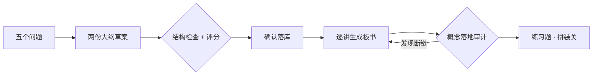

# first-bit

**输入一个主题，生成一套可以听讲、查看和修改的课程。**


在线版：<https://first-bit-beta.vercel.app>（Vercel 免费档，冷启动后首次访问约 1 秒）

## 这是什么

first-bit 是一个可以自行部署的课程生成器。输入学习主题或学校的课程大纲后，系统会先询问五项信息：已有基础、学习侧重、学习目标、课程规模和内容语言，然后生成可以修改的课程大纲。用户确认后，系统会逐讲生成板书，配合语音讲解逐句显示内容。每讲还包含三道诊断题和一个动手关卡。

它主要支持两种学习需求。自学技术的用户可以从零开始，按照生成的课程顺序学习；需要跟随学校教学进度的用户可以上传教学大纲或课件，课程内容以提供的材料为准，不额外编写材料之外的知识。

系统不仅生成文本，还会对课程结构进行检查，包括讲次数量、课程之间的前置关系、每道题是否只有一个正确答案，以及板书中使用的概念是否已经定义。检查不通过时，会根据错误清单重新生成。

## 运行示例

```console
$ npm start
[store ] json · data/store.json
[seed  ] 0 demo course(s), 2 total
[model ] glm-4-plus
[ready ] http://localhost:5200 (bind 0.0.0.0)
```

未配置 API key 时，第三行会显示 `[model ] 演示模式 · 内置课程`。此时仍可使用界面、查看示例课程和完成练习，但不能生成新课程。

内置示例课程《像素风个人主页制作》共 12 讲，内容已全部生成。每讲包含 **4–5 页板书**和 **3 道题**。

## 🚀 快速开始

运行需要 Node.js 20 或更高版本。

```bash
npm install
cp env.example env.local     # 填 key；不填也能启动
npm start                    # → http://localhost:5200
```

可以使用 `PORT=5201 npm start` 修改端口。`pdfjs-dist` 仅在解析上传的 PDF 时加载，未安装时不影响其他功能。

`env.local` 已加入 `.gitignore`。模型调用使用兼容 OpenAI 的接口，配置三个变量即可（见[配置](#配置)）。

## 🧭 两种学习模式

| | 跟课学 | 自由学 |
|---|---|---|
| 起点 | 上传大纲、课件或粘贴文字，也可以选内置样例 | 18 题兴趣问卷 → 方向 → 主题 |
| 课程范围 | 以材料为准 | 由主题和每周可投入时间决定（约 6 / 12 / 15 讲） |
| 界面 | 衬线标题、单元列表、侧栏统计 | 岛屿手帐：地标卡、小路、区域守关者 |
| 练习 | 三道诊断题 + 单元测试 | 三道题 + 拼装关 + 故障终端 |

兴趣问卷基于 Holland 的 RIASEC 六个维度设计（结构参考 O\*NET Interest Profiler，其 Creative Commons 授权允许改编）。题目改写为与学习活动有关的内容，使用本地规则计分，不调用模型。三个方向分别对应不同的六维权重。界面中说明了问卷属于改编版本，并非经过验证的中文量表，结果仅用于帮助用户选择学习方向。系统没有加入学习风格（VARK）测试。

自由学模式将课程单元显示为地图区域，将每一讲显示为节点。节点按照大纲中的前置关系依次解锁，因此地图结构也反映了课程内容之间的依赖关系。

## 课程生成流程



课程生成中主要采用以下四项处理方式：

- **生成两份大纲并比较**。根据同一份问卷，使用两种拆分规则并行生成大纲：一种按问题层次划分（现象 → 机制 → 边界 → 取舍），另一种按产出物划分（每个单元完成一个可以运行的成果）。两份大纲分别接受结构检查，再根据评分选择较好的一份。如果两份都不合格，则根据错误清单重新生成一次。
- **衔接前后课程内容**。生成第 N 讲时，将第 N-1 讲的板书摘要加入 prompt，要求模型引用上一讲的结论，避免重复讲解。
- **检查概念是否先定义再使用**。模型负责列出每讲使用的新概念，代码负责检查这些概念在首次出现的页面或之前是否有定义句，例如包含 `是指 / 就是 / 用来 / 作用是` 的句子。如果发现缺少定义，则重新生成一次，同时保留此前评分最好的一版，避免重新生成后修复了一个问题却出现其他问题。
- **固定题目选项顺序**。每讲三道题的正确答案通过哈希分配到三个不同位置。同一道题的选项顺序保持不变，因为错题卡和复习记录按选项位置保存。

## 🛡️ 生成结果检查

使用检查函数验证课程结构，出现以下问题时判定为不合格：

- 单元数 2–6；整门课至少 3 讲；讲数要和所选规模对得上（生成时严格，用户手动编辑时放宽）
- 每讲必须标注前置讲次，且只能指向更早的讲次，避免课程内容的先后顺序出现冲突
- 标题不能只使用「概述 / 入门 / 最佳实践 / 什么是」等缺少具体主题信息的表述
- 每页板书至少有一段讲解词，每题恰好一个正确项

模型输出的解析过程也加入了容错处理，可以修复未转义的换行、字符串中的引号以及键后缺少冒号等问题。如果解析失败，会提示上一次输出不是合法 JSON，并重试一次。超时和 HTTP 429 错误也会触发重试，短时熔断仅针对网络故障。

## 课堂、练习与复习

**板书课**：每讲包含 4–5 页板书，支持暂停和回看任意页面。按空格键可以播放或暂停，按 ← → 键可以翻页。讲解使用浏览器的语音合成功能（`speechSynthesis`）。用户可以随时输入问题，系统会结合当前页面回答，并提供相关页码。如果没有听懂，可以使用「换个说法重讲」，系统会用已经讲过的术语重新解释当前内容，而不是简单重复原答案。回答控制在 4–6 句、120–220 字。板书还可以导出为 Markdown 笔记。

**练习**：每讲包含三道单选题，错误选项对应常见的理解误区。答错后可以跳转到相关板书页面。已经掌握内容的用户可以按 Q 键直接进入练习，不需要先观看板书。

**复习**：答错的题会进入间隔复习，复习间隔为 1 → 3 → 7 → 14 → 30 天。单元测试结束后，可以使用「诊断薄弱点」功能。系统会把错题和所选错误选项对应的理解误区提交给模型，分析问题涉及哪些讲次。

**动手关**（自由学）：包含排序和连线题，答案保存在服务端，不发送给前端。故障终端提供 5–12 行包含 bug 的 JavaScript 代码，用户修改指定行后点击运行，三条测试用例会在前端 Web Worker 中实际执行。每道题保存前都会通过 `node:vm` 进行两次验证：原代码必须至少有一条测试不通过，替换修复代码后则必须全部通过。如果不满足条件，就改用预置题目。

## 🔌 接口

所有接口都定义在 `app/server.mjs`，静态资源仅开放 `app/public/`。下表按用途列出各接口及其请求方法。

| 用途 | 接口 |
|---|---|
| 建课 | `POST /api/outline` 出大纲，`GET /api/jobs/:id` 取任务进度 |
| 蓝图 | `PATCH /api/course/:id/outline` 保存编辑，`POST /api/course/:id/outline/ask` 问某个标题，`POST /api/course/:id/confirm` 开始建课 |
| 讲次 | `POST /api/course/:id/lesson/:lid` 生成（`?force=1` 重写），`GET` 同一路径读缓存 |
| 课堂 | `POST .../lesson/:lid/ask` 提问，`/page` 记页，`/complete` 记学完，`GET`/`POST /notes` 笔记 |
| 练习 | `POST .../answer` 判题，`GET .../unit/:uid/test` 单元卷，`POST .../unit/:uid/diagnose` 诊断，`GET .../review` 待复习 |
| 动手 | `POST .../battle/:key` 判分，`GET`/`POST .../craft/:lid` 拼装，`GET`/`POST .../terminal/:uid` 故障终端 |
| 导师 | `POST /api/course/:id/tutor` 答题时的提示，只指路不交卷 |
| 素材与学习者 | `POST /api/pdf-text` 解析 PDF，`GET /api/sample` 内置样例，`GET /api/player`、`POST /api/player/profile`、`POST /api/game/topic` |
| 账号 | `POST /api/auth/register`、`/login`、`/logout`，`GET /api/auth/me`；除这些与 `/api/config`、`/healthz` 外，其余接口无会话一律 401 |
| 管理端 | `GET /api/admin/overview`；账号 `POST/PATCH/DELETE /api/admin/users[/:id]`；课程 `GET/POST/PATCH/DELETE /api/admin/courses[/:id]`，非管理员一律 404 |

### 配置

| 变量 | 默认 | 说明 |
|---|---|---|
| `OPENAI_API_KEY` | 空 | 不填则进入演示模式，只读内置示例课 |
| `OPENAI_BASE_URL` | `https://api.openai.com/v1` | 任何 OpenAI 兼容端点；`env.example` 里填的是智谱 |
| `LLM_MODEL` | `gpt-4o-mini` | 跟随所选端点；仓库自用配置是 `glm-4-plus`，想免费可换 `glm-4-flash` |
| `LLM_TIMEOUT_MS` | 90000 | `env.example` 给的是 120000，留足冷启动时间 |
| `SESSION_SECRET` | 开发占位值 | 会话签名的 HMAC 密钥；线上必须设，否则每次重新部署都会把所有人登出 |
| `SIGNUP_PER_IP` | 3 | 同一 IP 十分钟内的注册上限 |
| `GEN_PER_DAY` | 20 | 每个账号每天的生成次数 |
| `GEN_PER_DAY_GLOBAL` | 120 | 全站每天的生成次数，防止共享 key 被刷 |
| `PORT` | 5200 | |

默认使用单个 JSON 文件（`data/store.json`）存储数据。写入时先保存到临时文件，再通过 `rename` 替换原文件，避免写入中断导致数据文件损坏。如果文件不可写，系统会切换到只读模式，仍然可以浏览已有内容。

## 🔑 账号与额度

账号主要用于保存和区分不同用户的课程、笔记和答题记录，防止其他用户查看或修改。注册后即可使用，目前没有邮箱验证和密码找回功能。

密码使用 `node:crypto` 中的 `scrypt` 和 16 字节随机盐进行哈希处理，不存储明文。会话使用无状态签名 cookie（`uid|ver|过期时间` + HMAC-SHA256），服务端不保存 session 表。这是考虑到 serverless 部署中实例可能被随时冻结，不同请求也可能由不同实例处理。使用服务端会话表可能导致登录状态丢失，而签名验证可以在本地完成。

这种方式的限制是**无法主动使某个单独的会话失效**。修改密码会将用户记录中的 `ver` 加一，使旧 cookie 失效；更换 `SESSION_SECRET` 则会使所有用户退出登录。

| 限制 | 目的 |
|---|---|
| 同 IP 十分钟 3 个号 | 脚本批量注册 |
| 每人每天 20 次生成 | 防止单个账号用完共享的模型额度 |
| 全站每天 120 次 | 限制全站模型调用量，避免产生过高费用 |

系统会先检查额度，再扣除生成次数。被拒绝的请求不计入额度，避免重复尝试消耗用户的次数。计数按照北京时间每天重置。

## 🛠 管理端

管理页面位于 `#/admin`，入口仅对管理员显示。管理端只提供增删改查功能。

- **账号管理**：新建账号、修改名称、重置密码（`ver` 加一，使该账号所有设备的登录状态失效）、设置或取消管理员权限，以及删除账号（同时删除所属课程、答题记录和笔记）。
- **课程管理**：查看大纲（标记尚未生成的讲次）、修改标题、副标题和归属账号，将课程复制给指定账号，以及删除课程及其进度。
- **权限限制**：不能取消最后一个管理员的权限，也不能删除最后一个管理员；管理员不能删除自己的账号。
- 权限检查在服务端进行，前端隐藏入口只是界面上的限制。非管理员访问 `/api/admin/*` 时会收到 404，而不是 403。

管理端只提供课程复制功能，没有新建课程入口。新建课程需要等待模型生成约一分钟，因此没有将这项操作放进管理页面。

## ☁️ 部署到 serverless

使用 `npm start` 时，服务作为常驻进程运行，数据保存在本地磁盘。部署到 Vercel 等 serverless 平台时，需要考虑文件系统只读，以及不同实例的内存和 `/tmp` 目录不共享的问题。项目已经做了相应适配，不需要修改业务代码：

| 文件 | 作用 |
|---|---|
| `api/index.mjs` | 函数入口，复用同一个 `handler`；响应前落盘、响应后把实例挂到生成结束 |
| `vercel.json` | 全路径重写到该函数，`maxDuration` 300 秒，打包 `app/public` 与 `content` |
| `app/kv.mjs` | 40 行 Redis REST 客户端，零依赖 |

使用 Redis 存储数据（Upstash 的免费额度可以满足当前需求）时，整个工作区保存在**一个 key** 中。实例冷启动时读取一次，数据修改后再写回 Redis。不同运行实例之间的数据最多在 `STORE_STALE_MS` 指定的时间内完成同步。

| 变量 | 默认 | 说明 |
|---|---|---|
| `UPSTASH_REDIS_REST_URL` / `..._TOKEN` | 空 | 配了就把存储切到 Redis；在 Vercel 装 Upstash 集成后自动注入 |
| `STORE_STALE_MS` | 700 | 实例多久回读一次共享副本 |
| `JOB_HOLD_MS` | 280000 | 响应之后继续等生成任务的上限 |

未配置 Redis 时，系统会使用 `/tmp` 存储。服务仍可启动并查看示例课程，但新建课程的数据可能在实例冷启动后丢失。

生成任务还需要处理实例生命周期的问题：实例会在 handler 的 promise 结束后被冻结，而不是在发送响应时立即冻结。因此，`POST /api/outline` 会先返回 `jobId`，入口通过 `drainJobs` 等待生成任务结束，并将进度快照同步写入 Redis。这样即使轮询请求由不同实例处理，也能读取当前任务进度。

## 项目结构

```
app/server.mjs        零依赖 HTTP 服务与全部接口
app/store.mjs         存储：本地 JSON 文件，或 Redis 里的单一快照
app/kv.mjs            Redis REST 客户端（Upstash / Vercel KV）
api/index.mjs         serverless 入口，vercel.json 是它的部署配置
app/public/js/        前端模块，无构建步骤
  home.js             建课问卷与蓝图编辑器
  classroom.js        板书课：逐页播放、追问、笔记导出
  world.js / map.js   问卷结果、闯关地图
  island.js           自由学的课程页
  battle.js           答题战与结算
  craft.js            拼装关：排序拖拽 + 连线
  terminal.js         故障终端
  tutor.js            答题浮层导师
  login.js            登录与注册
  admin.js            管理端：账号与课程的增删改查
  i18n.js + lang/     中英切换：t() + 渲染后 DOM 翻译，覆盖全部页面（含登录、管理端）
lib/auth.mjs          scrypt 密码哈希与 HMAC 会话签名
lib/course.mjs        归一化与结构检查
lib/generate.mjs      大纲 / 板书 / 追问 / 导师的 prompt
lib/llm.mjs           模型调用唯一入口，JSON 容错解析
lib/craft.mjs         拼装题：生成、合法性校验、判分
lib/bug.mjs           Bug 题生成与 node:vm 双验证
content/              内置示例课与样例素材
tools/                不在运行路径上：词表编译、结构测量、无头回归
```

