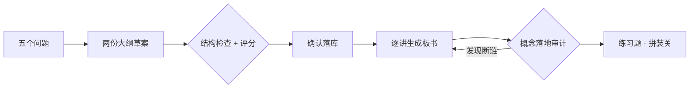

# first-bit

**给一个主题，编出一套能听、能看、能改的课。**


在线版：<https://first-bit-beta.vercel.app>（Vercel 免费档，冷启动后首次访问约 1 秒）

## 这是什么

first-bit 是一个自托管的课程生成器。你给一个主题或一份学校大纲，它先问五个问题——基础、侧重、目标、规模、内容语言——生成一份可编辑的课程蓝图；确认后逐讲生成板书：老师一边讲，板书一边一句句写出来。每讲配三道诊断题和一个动手关。

它面向两类人。想自学一门技术的人，从头拿到一套有路径的课；要跟着学校进度学的人，上传教学大纲或课件，知识范围以材料为准、材料没写的不编。

它不是一个聊天框套壳。生成出来的东西要过结构检查：讲数对不对、前置关系成不成立、每题是不是恰好一个正确项、板书里用到的概念有没有在前面定义过。不合格就带着错误清单重写。

## 一次真实运行

```console
$ npm start
[store ] json · data/store.json
[seed  ] 0 demo course(s), 2 total
[model ] glm-4-plus
[ready ] http://localhost:5200 (bind 0.0.0.0)
```

没有配 key 时第三行是 `[model ] 演示模式 · 内置课程`，其余照旧：界面、示例课、练习都能走，只是不能生成新课。

内置示例课《像素风个人主页制作》共 12 讲，全部已生成：每讲 **4–5 页板书**，每讲 **恰好 3 道题**。

## 🚀 快速开始

前置只有 Node ≥ 20。

```bash
npm install
cp env.example env.local     # 填 key；不填也能启动
npm start                    # → http://localhost:5200
```

换端口用 `PORT=5201 npm start`。上传 PDF 才会用到 `pdfjs-dist`，它在解析时才被加载，不装也能跑其余功能。

`env.local` 已在 `.gitignore` 里。模型走 OpenAI 兼容接口，填三个变量即可（见[配置](#配置)）。

## 🧭 两种学法

| | 跟课学 | 自由学 |
|---|---|---|
| 起点 | 上传大纲、课件或粘贴文字，也可以选内置样例 | 18 题兴趣问卷 → 方向 → 主题 |
| 课程范围 | 以材料为准 | 由主题和每周可投入时间决定（约 6 / 12 / 15 讲） |
| 界面 | 衬线标题、单元列表、侧栏统计 | 岛屿手帐：地标卡、小路、区域守关者 |
| 练习 | 三道诊断题 + 单元测试 | 三道题 + 拼装关 + 故障终端 |

问卷按 Holland 的 RIASEC 六维出题（结构取自 O\*NET Interest Profiler，Creative Commons 授权允许改编），题干改写成学习活动版本，本地规则计分、不调模型。三个方向各自映射到六维权重，界面上写明这是改编版、不是验证过的中文量表，结果只作起点。刻意不做学习风格（VARK）测试。

自由学的课程页把「单元 = 区域、讲 = 节点」直接画成地图，解锁顺序吃的就是大纲里的前置链，所以地图的形状等于课程本来的依赖关系。

## 主题怎么变成课



四个决定质量的实现细节：

- **大纲出两版再比**。同一份问卷，换一条拆分规则并行生成两份：一份按问题层次拆（现象 → 机制 → 边界 → 取舍），一份按产出物拆（每单元交付一个能跑的东西）。两份都过结构检查，再按分数取高的；两版都不合格，才回到「带错误清单重写一次」。
- **每讲的板书带着上一讲的结论**。生成第 N 讲时把第 N-1 讲的板书摘要注入 prompt，要求直接引用而不重讲。
- **概念先定义再引用**。模型只负责列出「这一讲用了哪些新概念」，判断交给代码：在首次出现的那一页及之前，有没有一句带 `是指 / 就是 / 用来 / 作用是` 这类标志的定义句。发现断链就重写一次，并且保留历史上最好的一版——因为重写常常补一个、掉一个。
- **答案不会总在第一个**。一讲三道题，正确答案由哈希分配到三个不同槽位；同一道题每次拿到的排列相同，因为错题卡和复习记录都按位置记。

## 🛡️ 生成质量闸门

使用检查器函数来检查课程结构，以下几类问题直接判不合格：

- 单元数 2–6；整门课至少 3 讲；讲数要和所选规模对得上（生成时严格，用户手动编辑时放宽）
- 每讲必须标注前置讲次，且只能指向更早的讲——防「第三章要用第二章的东西，但第二章排在后面」
- 标题不能是「概述 / 入门 / 最佳实践 / 什么是」这类放到任何主题上都成立的话
- 每页板书至少有一段讲解词，每题恰好一个正确项

模型侧的容错也在这里：裸换行、字符串里的裸引号、键后丢冒号都能修；解析失败会带「上次不是合法 JSON」重试一次；超时和 429 重试，短时熔断只对网络故障生效。

## 课堂、练习与复习

**板书课**：每讲 4–5 页，可暂停、回看任意页；空格播放/暂停，← → 翻页。讲解用浏览器语音合成（`speechSynthesis`）。随时打字提问，回答贴着当前这一页并给出回看页码。没听懂可以按「换个说法重讲」——不重新回答，而是退半步、换一种说法、只用已经讲过的术语，答案控制在 4–6 句、120–220 字。板书可导出为 Markdown 笔记。

**练习**：三道单选题，错误选项是设计过的常见误解；答错跳回写它的那一页。已经会的人按 Q 直接做题，不必先看十分钟板书。

**复习**：答错的题进间隔复习，间隔 1 → 3 → 7 → 14 → 30 天。单元测试后可以「诊断薄弱点」，把错题和选错的误解项一起交给模型，指出断在哪几讲。

**动手关**（自由学）：排序与连线，答案在服务端，前端拿不到。故障终端给 5–12 行带 bug 的 JS，改那一行、点运行，三条用例在前端 Web Worker 里真跑；每题入库前都在 `node:vm` 里双验证过——坏代码必须有用例失败，换成修复行必须全过，不成立就换预置题。

## 🔌 接口

所有接口都在 `app/server.mjs`，静态资源只暴露 `app/public/`。下表按用途分组，方法已核对源码。

| 用途 | 接口 |
|---|---|
| 建课 | `POST /api/outline` 出大纲，`GET /api/jobs/:id` 取任务进度 |
| 蓝图 | `PATCH /api/course/:id/outline` 保存编辑，`POST /api/course/:id/outline/ask` 问某个标题，`POST /api/course/:id/confirm` 开始建课 |
| 讲次 | `POST /api/course/:id/lesson/:lid` 生成（`?force=1` 重写），`GET` 同一路径读缓存 |
| 课堂 | `POST .../lesson/:lid/ask` 提问，`/page` 记页，`/complete` 记学完，`GET`/`POST /notes` 笔记 |
| 练习 | `POST .../answer` 判题，`GET .../unit/:uid/test` 单元卷，`POST .../unit/:uid/diagnose` 诊断，`GET .../review` 待复习 |
| 动手 | `POST .../battle/:key` 判分，`GET`/`POST .../craft/:lid` 拼装，`GET`/`POST .../terminal/:uid` 故障终端 |
| 导师 | `POST /api/course/:id/tutor` 答题时的提示，只指路不交卷 |
| 素材与学习者 | `POST /api/pdf-text` 解析 PDF，`GET /api/sample` 内置样例，`GET /api/player`、`POST /api/player/profile`、`POST /api/game/topic` |
| 账号 | `POST /api/auth/register`、`/login`、`/logout`，`GET /api/auth/me`；除这些与 `/api/config`、`/healthz` 外，其余接口无会话一律 401 |

### 配置

| 变量 | 默认 | 说明 |
|---|---|---|
| `OPENAI_API_KEY` | 空 | 不填则进入演示模式，只读内置示例课 |
| `OPENAI_BASE_URL` | `https://api.openai.com/v1` | 任何 OpenAI 兼容端点；`env.example` 里填的是智谱 |
| `LLM_MODEL` | `gpt-4o-mini` | 跟随所选端点；仓库自用配置是 `glm-4-plus`，想免费可换 `glm-4-flash` |
| `LLM_TIMEOUT_MS` | 90000 | `env.example` 给的是 120000，留足冷启动时间 |
| `SESSION_SECRET` | 开发占位值 | 会话签名的 HMAC 密钥；线上必须设，否则每次重新部署都会把所有人登出 |
| `SIGNUP_PER_IP` | 3 | 同一 IP 十分钟内的注册上限 |
| `GEN_PER_DAY` | 20 | 每个账号每天的生成次数 |
| `GEN_PER_DAY_GLOBAL` | 120 | 全站每天的生成次数，防止共享 key 被刷 |
| `PORT` | 5200 | |

数据默认只落在一个 JSON 文件（`data/store.json`）。写入走临时文件 + `rename`，避免写到一半断电把整份数据写坏；文件不可写时降级为只读，界面仍能浏览。

## 🔑 账号与额度

账号存在的理由很窄：课程、笔记、答题记录得有个归属，别人打开链接看不到也不改不了。所以没有"注册即用"之外的流程——没有邮箱验证，没有找回密码，也没有管理员后台。

密码用 `node:crypto` 的 `scrypt` 加 16 字节随机盐，不落明文；会话是无状态签名 cookie（`uid|ver|过期时间` + HMAC-SHA256），服务端不存 session 表。理由是部署在 serverless 上：实例随时冻结、请求随时落到另一个实例，任何"服务端会话表"都会莫名掉线，而验签是纯本地计算。

代价说清楚：**单个会话没法主动踢掉**。改密码会把用户记录上的 `ver` 加一，旧 cookie 随即失效；轮换 `SESSION_SECRET` 则是全员登出。

| 闸门 | 挡什么 |
|---|---|
| 同 IP 十分钟 3 个号 | 脚本批量注册 |
| 每人每天 20 次生成 | 一个号把共享的模型额度吃光 |
| 全站每天 120 次 | 你睡一觉起来发现欠费 |

额度先判后扣：被拒的请求不计数，否则重试两次就把自己的份额烧完了。计数按北京时间跨日重置。

## ☁️ 部署到 serverless

`npm start` 是长驻进程，数据落在磁盘上。换到 Vercel 这类 serverless 平台时有两个平台事实要处理：文件系统只读，且每个实例的内存与 `/tmp` 互不相通。仓库里已经适配好，不需要改业务代码：

| 文件 | 作用 |
|---|---|
| `api/index.mjs` | 函数入口，复用同一个 `handler`；响应前落盘、响应后把实例挂到生成结束 |
| `vercel.json` | 全路径重写到该函数，`maxDuration` 300 秒，打包 `app/public` 与 `content` |
| `app/kv.mjs` | 40 行 Redis REST 客户端，零依赖 |

数据放到 Redis（Upstash 免费额度够用）后，整份工作区就是**一个 key**：冷启动读一次，改动后写回，两个热实例之间最迟 `STORE_STALE_MS` 内对齐。

| 变量 | 默认 | 说明 |
|---|---|---|
| `UPSTASH_REDIS_REST_URL` / `..._TOKEN` | 空 | 配了就把存储切到 Redis；在 Vercel 装 Upstash 集成后自动注入 |
| `STORE_STALE_MS` | 700 | 实例多久回读一次共享副本 |
| `JOB_HOLD_MS` | 280000 | 响应之后继续等生成任务的上限 |

没配 Redis 时退回 `/tmp`：能启动、能看示例课，但新建的课程活不过一次冷启动。

生成任务还有一处细节：实例是在 handler 的 promise 结束时被冻结的，而不是响应发出时。所以 `POST /api/outline` 立刻返回 `jobId`，入口把 promise 挂到生成结束（`drainJobs`），进度快照同步写进 Redis——轮询落到哪个实例都能读到当前阶段。

## 项目结构

```
app/server.mjs        零依赖 HTTP 服务与全部接口
app/store.mjs         存储：本地 JSON 文件，或 Redis 里的单一快照
app/kv.mjs            Redis REST 客户端（Upstash / Vercel KV）
api/index.mjs         serverless 入口，vercel.json 是它的部署配置
app/public/js/        前端模块，无构建步骤
  home.js             建课问卷与蓝图编辑器
  classroom.js        板书课：逐页播放、追问、笔记导出
  world.js / map.js   问卷结果、闯关地图
  island.js           自由学的课程页
  battle.js           答题战与结算
  craft.js            拼装关：排序拖拽 + 连线
  terminal.js         故障终端
  tutor.js            答题浮层导师
  i18n.js + lang/     中英切换：t() + 渲染后 DOM 翻译
lib/course.mjs        归一化与结构检查
lib/generate.mjs      大纲 / 板书 / 追问 / 导师的 prompt
lib/llm.mjs           模型调用唯一入口，JSON 容错解析
lib/craft.mjs         拼装题：生成、合法性校验、判分
lib/bug.mjs           Bug 题生成与 node:vm 双验证
content/              内置示例课与样例素材
tools/                不在运行路径上：词表编译、结构测量、无头回归
```

